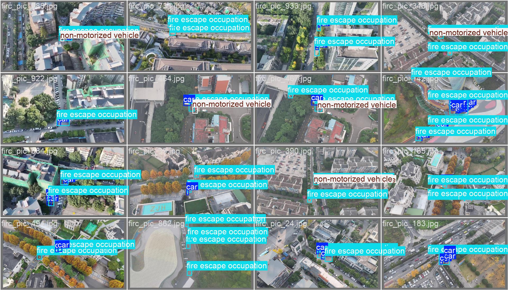
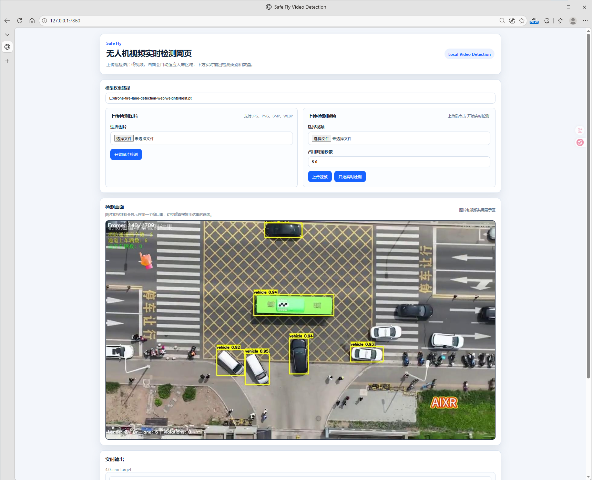
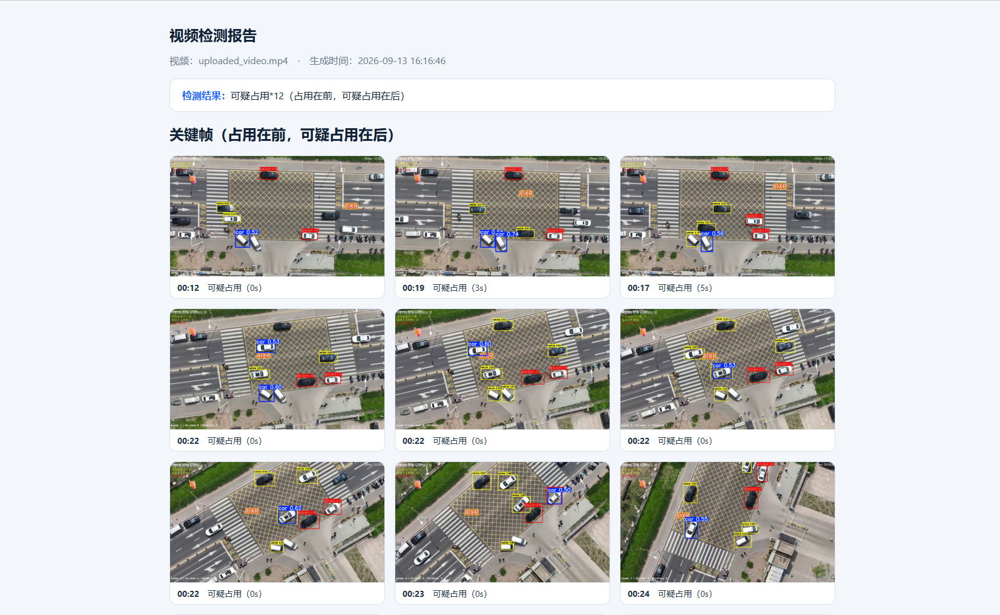

# Drone-Assisted Fire Lane Occupancy Detection System

> A computer vision project that uses drone inspection footage to identify potential obstructions in emergency access routes and turn them into reviewable visual evidence.

**Project by:** Xing'er Li  
**Project year:** 2026

> **[AUTHOR PHOTO PLACEHOLDER]**  
> Add the project author's photo here.

---

## The Problem

Fire lanes are essential for emergency response, but they can be blocked by vehicles or other objects. Manual inspection is time-consuming, especially when inspectors need to review long videos or cover a large area. Fixed cameras may also provide limited coverage or inflexible viewpoints.

This project explores a practical first-pass inspection workflow that combines drone footage with computer vision while keeping a human reviewer in the loop.

### Why Use a Drone?

A drone can capture wider areas and more flexible viewpoints than a single fixed camera. In this project, the drone is the data-collection layer: it records inspection footage that can later be analyzed by the detection model.

---

## The Project

The prototype connects four steps into one inspection workflow:

1. **Capture:** collect fire-lane footage with a drone.
2. **Detect:** analyze images or video frames with a YOLO-based object detection model.
3. **Review:** display annotated results and detection information in a web interface.
4. **Report:** preserve key frames and detection information for later review.

```text
Drone inspection footage
          ↓
   Computer vision detection
          ↓
       Web-based review
          ↓
     Inspection evidence
```

---

## Project Showcase

### Drone Inspection Input

**[ADD ORIGINAL DRONE INSPECTION PHOTO HERE]**

*Original footage collected during a fire-lane inspection.*

### Detection Output



*The detection model highlights objects identified in the inspection frame.*

### Web Application



*A web interface for uploading inspection media and reviewing detection results.*

### Generated Report



*Key frames and detection information are organized into an inspection report.*

---

## Project Demo Video

[Add the final 2-3 minute English demo video link here]

The video shows the complete workflow:

**Problem → Drone inspection → Detection → Web review → Generated report**

---

## How It Works

### Capture

The drone records inspection footage from an elevated and flexible viewpoint. This footage becomes the input to the detection workflow.

### Detect

The trained YOLO model analyzes an image or processes a video frame by frame. It identifies relevant objects and returns bounding boxes, class labels, and confidence scores.

### Review

The web application displays the annotated image or video together with detection information. Images and videos share the same result area, making the workflow easier to follow.

### Report

After video processing, the system organizes selected key frames and detection information into an HTML report. The report makes the results easier to save, review, and discuss.

---

## Results

The prototype demonstrates that drone inspection footage can be connected to a YOLO detection workflow and presented through a practical web interface. It can:

- process uploaded images and inspection videos;
- identify relevant objects and display visual detection results;
- show detection information during video processing;
- preserve selected key frames and report information.

---

## My Contribution

As the project developer, I completed the main technical and research work, including:

- organizing and preparing the detection data;
- training and testing the YOLO detection model;
- developing the image and video detection workflow;
- building the Flask-based web interface;
- connecting model inference to the result display;
- designing the inspection report generation process;
- evaluating the prototype and documenting its limitations.

---

## Limitations and Next Steps

The current prototype performs best on scenes similar to its training data. Changes in lighting, flight altitude, camera angle, distance, background, and object appearance can affect detection quality. The system is designed to support human review, not to replace professional inspection or make final enforcement decisions.

Next steps include:

- collecting more diverse drone inspection footage;
- improving generalization to new locations and viewpoints;
- adding object tracking to reduce repeated counting in videos;
- exploring live drone video input;
- improving report summaries and alert functions.

---

## Technology

- **Drone footage:** inspection input
- **YOLO:** object detection
- **OpenCV:** video frame processing
- **Flask:** web application backend
- **HTML, CSS, and JavaScript:** browser interface
- **HTML report generation:** inspection record output

The central idea is the workflow: **drone collection → AI detection → web review → inspection evidence**.
