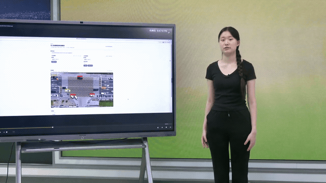
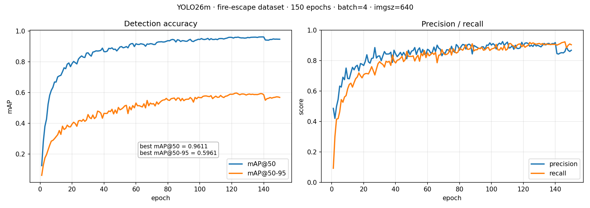

# The Fire Lane Was Blocked. Nobody Was Looking.

**Fire-lane occupancy detection from drone footage** · Xing'er Li · 2026

> A fire truck pulls into a housing complex at 2 a.m. The gate is blocked by a car that has been sitting there for hours. Nobody writes it down, so nobody follows up.
>
> This project builds the record. Drone footage goes in, a fine-tuned YOLO26m detector finds the vehicles and the occupied lane areas, a web interface lets a reviewer watch the detection and sort each target by how long it stayed, and the system writes an inspection report a property manager can act on.

[](https://xc-done.github.io/drone-fire-lane-detection-web/)

### ▶ [Open the project page](https://xc-done.github.io/drone-fire-lane-detection-web/)

*The page plays the full 1:53 demo inline — no download — next to the evaluation results and screenshots.*

## Author

> **[AUTHOR PHOTO PLACEHOLDER]**

**Name:** Xing'er Li  
**School:** [Add school name]  
**Grade:** [Add grade]  
**Location:** [Add city and country]

**Mentor:** [Optional]

---

## The Problem

Fire lanes are still inspected the way they were twenty years ago. Someone walks the estate, or someone scrubs through recorded video. Both are slow, both are easy to skip, and neither leaves a record you can point at later. Fixed cameras help, but coverage stays partial and the viewpoint never changes.

A drone fixes the capture side: one flight covers a whole compound from above, and the camera looks down on the lane markings instead of at whatever is parked in front of them. What is left is the other half of the job — turning that footage into annotated frames, occupancy durations, and a report someone can act on. That is what this project builds.

---

## The Project

The prototype connects four steps into one inspection workflow:

1. **Capture:** collect fire-lane footage with a drone.
2. **Detect:** analyze images or video frames with a YOLO-based object detection model.
3. **Review:** display annotated results and detection information in a web interface.
4. **Report:** preserve key frames and detection information for later review.

```text
Drone inspection footage
          ↓
   Computer vision detection
          ↓
       Web-based review
          ↓
     Inspection evidence
```

---

## Project Showcase

### Drone Inspection Input

**[ADD ORIGINAL DRONE INSPECTION PHOTO HERE]**

*Original footage collected during a fire-lane inspection.*

### Detection Output


*The detection model highlights objects identified in the inspection frame.*

### Web Application


*A web interface for uploading inspection media and reviewing detection results.*

### Generated Report


*Key frames and detection information are organized into an inspection report.*

---

## Project Demo Video

**[▶ Open the project page to watch the demo (1:53)](https://xc-done.github.io/drone-fire-lane-detection-web/)** — plays inline in the browser, no download.

The video shows the complete workflow:

**Problem → Drone inspection → Detection → Web review → Generated report**

The page is served from this repository by GitHub Pages ([`index.html`](index.html)).
The raw file is also available as [`assets/demo.mp4`](assets/demo.mp4) (1:53, 1920×1080,
91 MB, original recording); a short silent preview plays at the top of this page.

---

## How It Works

### Capture

The drone records inspection footage from an elevated and flexible viewpoint. This footage becomes the input to the detection workflow.

### Detect

The trained YOLO model analyzes an image or processes a video frame by frame. It identifies relevant objects and returns bounding boxes, class labels, and confidence scores.

### Review

The web application displays the annotated image or video together with detection information. Images and videos share the same result area, making the workflow easier to follow.

### Report

After video processing, the system organizes selected key frames and detection information into an HTML report. The report makes the results easier to save, review, and discuss.

---

## Results

The prototype demonstrates that drone inspection footage can be connected to a YOLO detection workflow and presented through a practical web interface. It can:

- process uploaded images and inspection videos;
- identify relevant objects and display visual detection results;
- show detection information during video processing;
- preserve selected key frames and report information.

### Detection Model Performance

`weights/best.pt` is a YOLO26m model fine-tuned for 150 epochs on the
`firc-dataset` fire-escape dataset (944 images, 3 classes, 4567 boxes),
split 755 / 94 / 95 for train / val / test.

| Metric | Value |
|---|---|
| Precision | 0.911 |
| Recall | 0.899 |
| mAP@50 | **0.958** |
| mAP@50-95 | **0.596** |



- Full per-epoch history: [`results/results.csv`](results/results.csv)
- Evaluation notes and caveats: [`results/metrics.md`](results/metrics.md)
- Training script: [`train.py`](train.py) · dataset split script: [`scripts/prepare_fly_dataset.py`](scripts/prepare_fly_dataset.py)

---

## My Contribution

As the project developer, I completed the main technical and research work, including:

- organizing and preparing the detection data;
- training and testing the YOLO detection model;
- developing the image and video detection workflow;
- building the Flask-based web interface;
- connecting model inference to the result display;
- designing the inspection report generation process;
- evaluating the prototype and documenting its limitations.

---

## Limitations and Next Steps

The current prototype performs best on scenes similar to its training data. Changes in lighting, flight altitude, camera angle, distance, background, and object appearance can affect detection quality. The system is designed to support human review, not to replace professional inspection or make final enforcement decisions.

Next steps include:

- collecting more diverse drone inspection footage;
- improving generalization to new locations and viewpoints;
- adding object tracking to reduce repeated counting in videos;
- exploring live drone video input;
- improving report summaries and alert functions.

---

## Technology

- **Drone footage:** inspection input
- **YOLO:** object detection
- **OpenCV:** video frame processing
- **Flask:** web application backend
- **HTML, CSS, and JavaScript:** browser interface
- **HTML report generation:** inspection record output

The central idea is the workflow: **drone collection → AI detection → web review → inspection evidence**.
