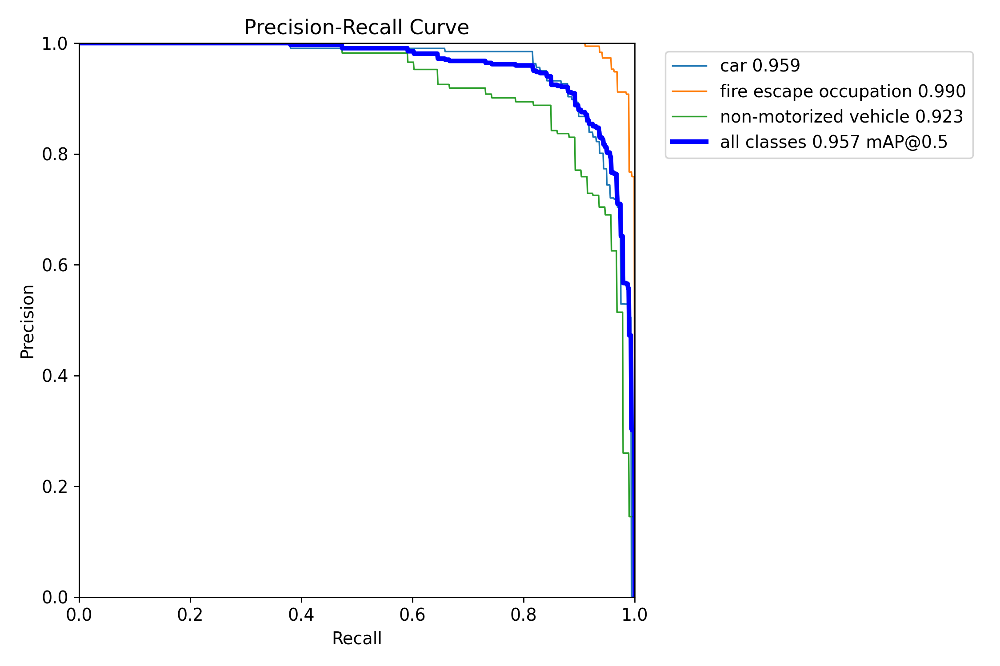
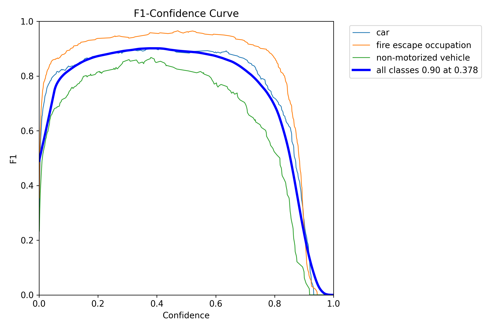
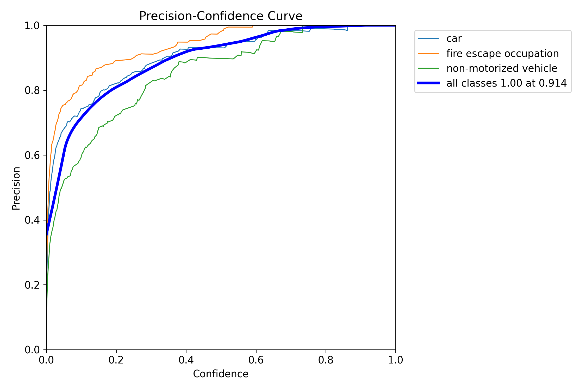
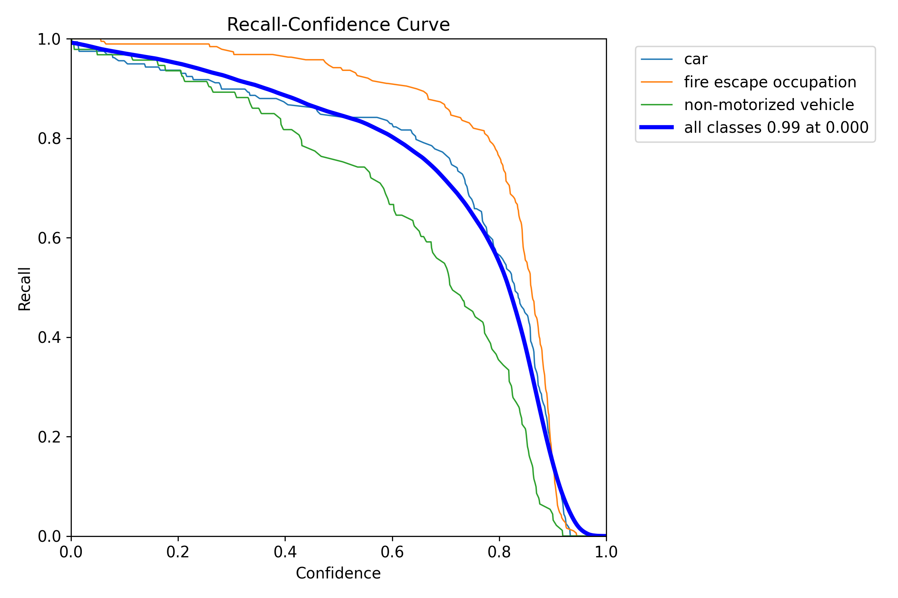
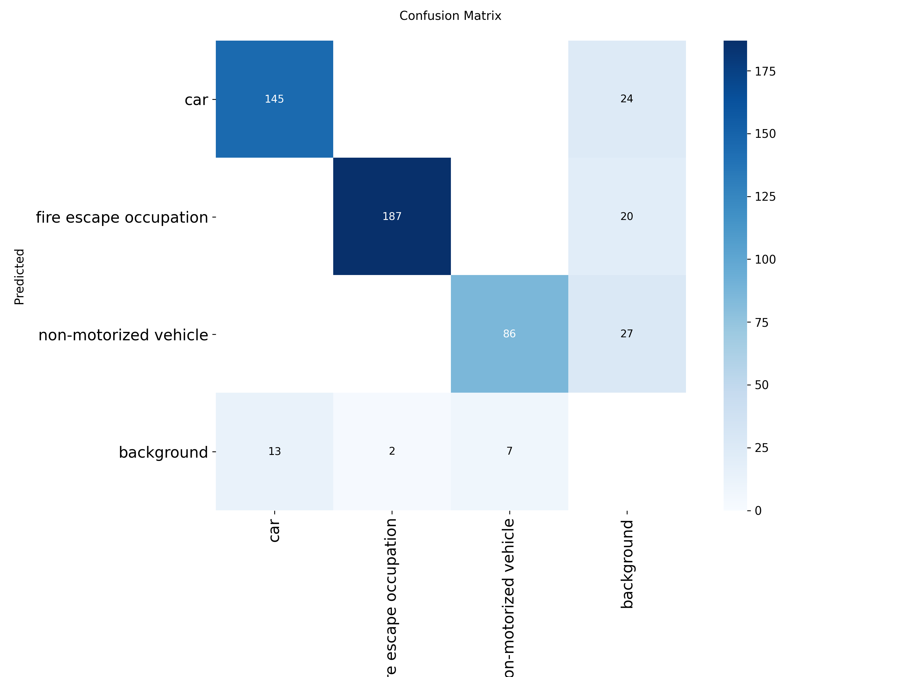
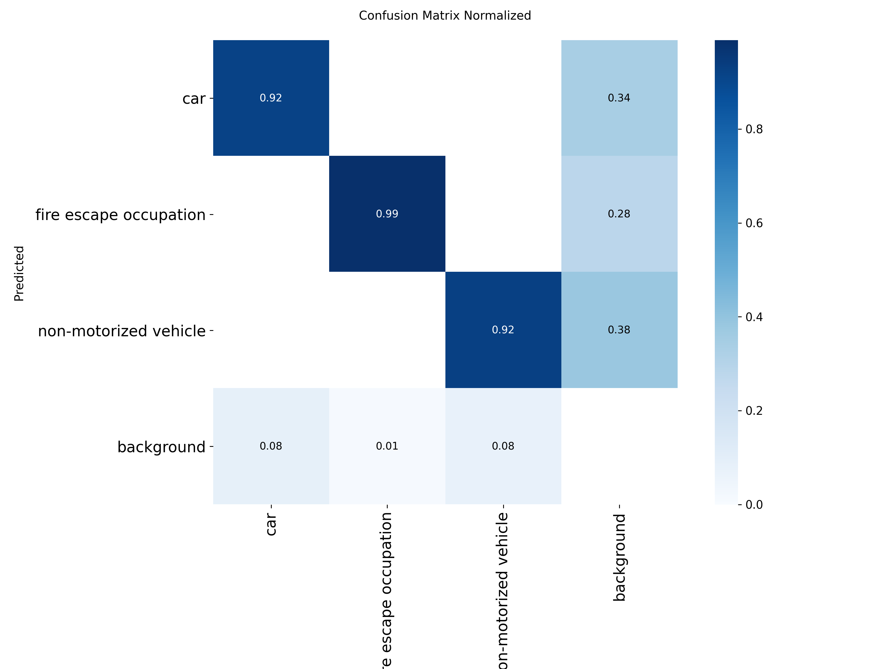

# Model Evaluation

Metrics for `weights/best.pt` (YOLO26m, fire-escape dataset).

## Headline

| Metric | Value |
|---|---|
| Precision (B) | **0.9110** |
| Recall (B) | **0.8988** |
| mAP@50 | **0.9581** |
| mAP@50-95 | **0.5961** |
| Validation set | 94 images / 440 instances |
| Epochs trained | 150 (no early stop) |

Best epoch observed during training:

| Metric | Best | Final (epoch 150) |
|---|---|---|
| mAP@50 | 0.9611 | 0.9461 |
| mAP@50-95 | 0.5961 | 0.5675 |
| Precision | 0.9239 | 0.8669 |
| Recall | 0.9224 | 0.9033 |


Per-epoch history: [`results.csv`](results.csv).

## Training configuration

Read back from the checkpoint's own `train_args` field:

```text
model       yolo26m.pt          imgsz       640
data        fire_escape.yaml    batch       4
epochs      150                 optimizer   AdamW
patience    30                  lr0         0.0003
cos_lr      True                warmup      3 epochs
mosaic      1.0                 close_mosaic 10
mixup       0.2                 copy_paste  0.3
```

Trained on a single NVIDIA RTX 5070 (12 GB), ~4031 s wall clock.

## Where these numbers come from

The original training workspace (`E:\ultralytics-main\runs\fire_escape\gen2`)
no longer exists, so `results.csv` and this table were reconstructed from the
checkpoint itself:

- `train_metrics` → the four aggregate numbers above;
- `train_results` → the 150-row per-epoch history;
- `train_args` → the hyperparameters.

Rebuild them at any time:

```bash
python scripts/export_results.py
```

## Validation plots

Output of `model.val()` on the 94-image validation split. The F1 curve reports
`all classes 0.90 at 0.378`, consistent with precision 0.911 / recall 0.899
(F1 = 2PR/(P+R) = 0.905), so these plots belong to the shipped `best.pt`.

| Precision–Recall | F1–Confidence |
|---|---|
|  |  |

| Precision–Confidence | Recall–Confidence |
|---|---|
|  |  |

| Confusion matrix | Confusion matrix (normalized) |
|---|---|
|  |  |

Per-class behaviour visible in the plots:

- Normalized diagonal: `fire escape occupation` **0.99**, `car` **0.92**,
  `non-motorized vehicle` **0.92**.
- The residual on the diagonal goes to *background* (8% / 1% / 8%), i.e. missed
  detections — the classes are almost never confused with each other.
- The background column (0.34 / 0.28 / 0.38) is background regions being
  predicted as targets, i.e. the false-positive source that keeps overall
  precision at 0.911.
- F1 peaks at 0.90 with a confidence threshold of 0.378.

## Caveats

- Only **aggregate** numeric metrics were stored in the checkpoint
  (`train_metrics` / `train_results`). The per-class view above comes from the
  saved validation plots, not from re-running `model.val()`, so class-wise
  numbers are read off the curves and the confusion matrix rather than
  reported to 4 decimals.
- The validation split comes from the same public dataset as training, so
  0.958 mAP@50 reflects in-distribution performance. It is **not** a measure of
  generalization to new flights, altitudes, or lighting.
